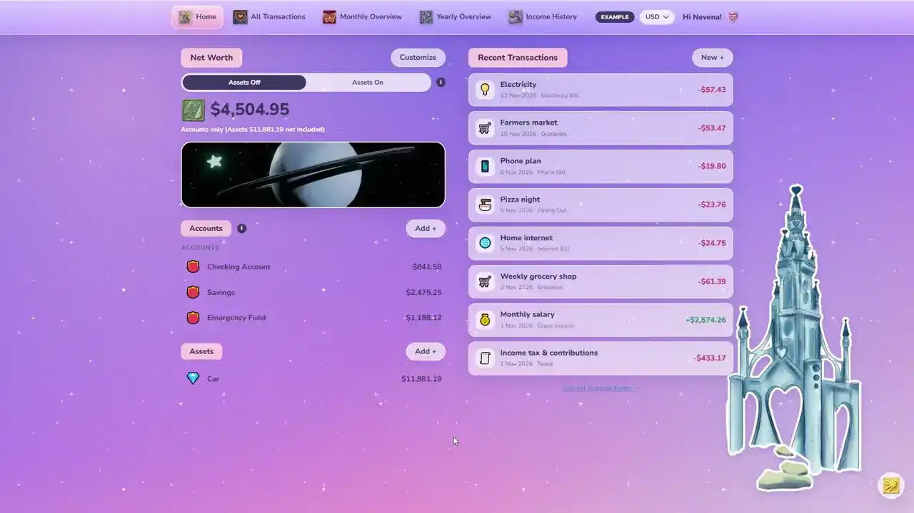

# ✨ Starry Budget

A dreamy personal budgeting app for tracking spending, planning your months and watching your savings grow, in RSD, EUR or USD.

**Live demo:** https://nev-hris.github.io/Starry-Budget/



## Features

- **Welcome page**: explore a ready-made example budget (three months of sample data) or start your own empty budget
- **Home**: net worth (with or without assets), accounts, assets and recent transactions
- **All Transactions**: search, date range, money in/out, category and future-transaction filters, with a table or cards view
- **Monthly Overview**: category breakdown with editable budgets, money in vs out, weekly spending, a top-8 donut chart, category groups and cumulative spend vs budget
- **Yearly Overview**: year-to-date net, gross and tax, spending by group, savings mix, top categories and months, and monthly averages
- **Income History**: one entry per year, with salary and hourly-wage charts and your age for each year
- **Currencies**: switch between RSD, EUR and USD at any time
- **Light and dark mode**, twinkling star background, animated illustrations and a sparkle cursor trail
- **Saves automatically** in your browser (localStorage), with no account needed
- **Responsive**: works on desktop, tablet and phone

## Built with

| Tool                                         | Version                  |
| -------------------------------------------- | ------------------------ |
| [React](https://react.dev)                   | 19.3                     |
| [TypeScript](https://www.typescriptlang.org) | 7.0                      |
| [Vite](https://vite.dev)                     | 8.3                      |
| [Tailwind CSS](https://tailwindcss.com)      | 4.3                      |
| GitHub Actions + GitHub Pages                | for automatic deployment |

## Run it locally

You need [Node.js](https://nodejs.org) (version 20.19 or newer).

```bash
# 1. Install the packages (only needed once)
npm install

# 2. Start the development server
npm run dev
```

## Project structure

```
src/
├── config/defaults.ts   ← default data & settings (currencies, categories, example budget)
├── pages/               ← one file per page (Home, Transactions, Monthly, Yearly, Income)
├── components/          ← shared pieces (top bar, welcome screen, charts, theme button…)
├── forms/               ← the pop-up form and every form that uses it
├── state/               ← the open budget + saving it to localStorage
├── hooks/               ← small helpers (money formatting, page from the URL)
├── lib/                 ← plain helper functions (dates, money, storage)
├── styles/              ← the design, split into small CSS files
├── types.ts             ← what the saved data looks like
├── App.tsx              ← puts the whole app together
└── main.tsx             ← starting point
```
